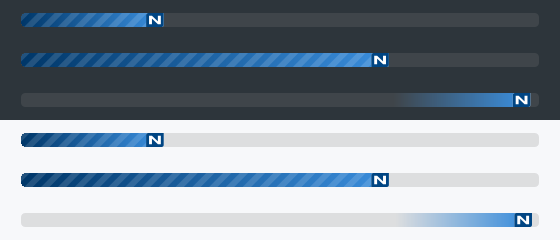

# Nowina Progress Bar

Replaces every IntelliJ progress bar with a Nowina-branded one, in the spirit of Mario Progress Bar.



- **Determinate** — navy → light-blue gradient with scrolling stripes; the N logo rides the leading edge.
- **Indeterminate** — the N logo bounces left/right with a fading trail.

> Personal use only: the Nowina logo is a trademark — don't publish this on the Marketplace.

## How it works

```
src/main/java/perso/nowina/progress/
├── NowinaLafListener.java     # registers our UI class in Swing's UIManager
├── NowinaProgressBarUi.java   # paints the bar (extends BasicProgressBarUI)
└── NowinaLogo.java            # the N logo as vector paths (from nowina.lu's SVG)
src/main/resources/META-INF/
├── plugin.xml                 # declares the listeners
└── pluginIcon.svg             # icon shown in Settings → Plugins
```

1. **Swing look-and-feel hook.** Every Swing `JProgressBar` asks `UIManager` for its UI delegate
   under the key `"ProgressBarUI"`. `NowinaLafListener` puts our class there.
2. **Why a listener.** Changing the IDE theme rebuilds the Swing defaults and wipes our entry, so the
   listener re-installs it on `LafManagerListener.lookAndFeelChanged` (and on window activation as a
   safety net). It is declared in `plugin.xml` under `<applicationListeners>` — no code needed to subscribe.
3. **Painting.** `NowinaProgressBarUi` overrides `paintDeterminate` / `paintIndeterminate` and draws
   with Java2D: rounded track, gradient fill, stripes, then the logo. Animations are clock-based:
   each paint schedules the next with `c.repaint(delay)`; Swing ignores repaints of hidden components,
   so the loop stops on its own.
4. **The logo.** `NowinaLogo` is the SVG path converted to `Path2D` (`M`/`L`/`H`/`V`/`C` → `moveTo`/
   `lineTo`/`curveTo`). The N is a hole thanks to the even-odd fill rule; a white box is painted
   first so the N shows white. Vector = sharp on HiDPI.

## Build / test

```bash
./gradlew buildPlugin   # build/distributions/nowina-progress-bar-1.0.0.zip
./gradlew runIde        # sandbox IDE with the plugin: open a project and watch indexing
```
Disable **Mario Progress Bar** when this one is enabled — both replace the same Swing UI, last one wins.
